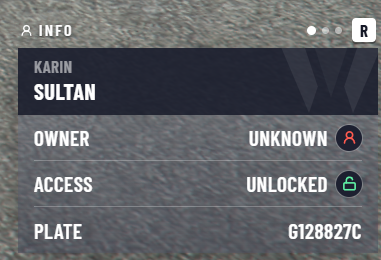
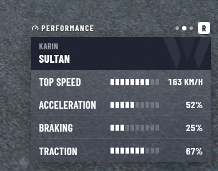
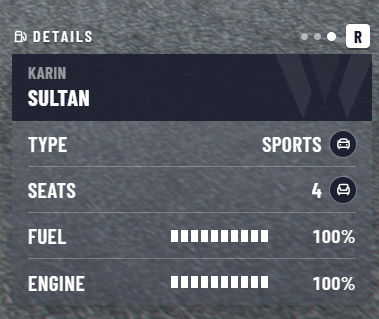
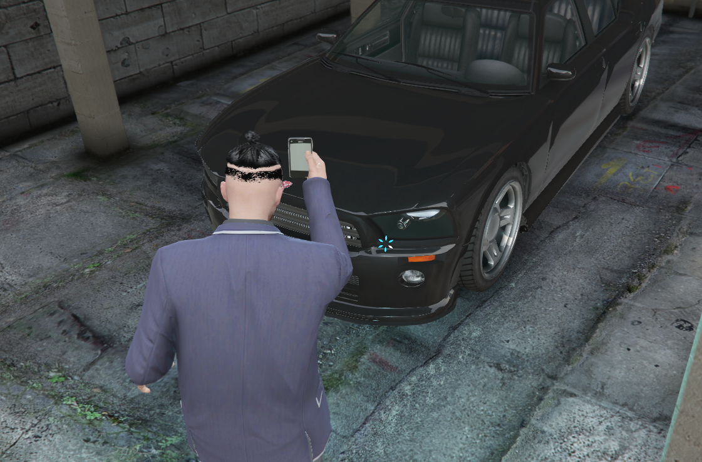

# sxWaink

A vehicle scanner for **ESX or standalone** FiveM servers. Players turn the scanner on with a key or from the lb-phone app, aim at a vehicle, hold the button to scan it and get its owner, lock state, performance and condition in a widget.






## Features

- **Phone app**: with lb-phone, a Waink app in the phone menu turns the scanner on or off directly, without any interface, and closes the phone.
- **Scan**: turn the scanner on with a key or the phone app, aim at a vehicle and hold the attack button. The petals of the crosshair fill up during the scan. Releasing the button or losing the vehicle from the crosshair does not reset the scan, the progress slowly goes down and the scan resumes where it was when the player aims back at the same vehicle.
- **Distance and speed**: a far or moving vehicle takes longer to scan, and a vehicle going faster than the player above a limit cannot be scanned, the crosshair turns red.
- **Plate visibility**: the scan needs to see the plate, so the player must stand in front of or behind the vehicle, behind only for motorcycles.
- **Sound and vibration**: the phone beeps when a scan starts, plays a camera shutter heard by the players around when it completes, then a success or failure sound. The crosshair and the controller vibrate on each result.
- **Phone light**: the screen of the phone lights up and pulses while a scan is in progress, and the players around see it.
- **Phone animation**: the scan is done with the phone, so the character takes a phone out and holds it up while the scanner is on, with a dedicated pose in vehicles. Weapons are put away and restored when the scanner is turned off, and the player cannot sprint, shoot or punch while it is on.
- **Owner lookup**: the server reads the plate of the vehicle and finds its owner in the ESX `owned_vehicles` table, or in the owners registered by your other resources. Results are cached.
- **Checks**: access by job and grade or ACE permission, cooldown and distance checked by the server.
- **History**: the last scans are kept per character with the resource KVP and exposed through the exports.
- **Vehicle widget**: three pages, info (owner, lock state, plate), performance (top speed, acceleration, braking, traction) and details (class, seats, fuel, engine), switched with a key.
- **Units**: top speed in km/h or mph, following the game settings or forced in the config.
- **Translations**: English and French, shared between Lua and the interface.
- **Exports**: a server API to register vehicle owners and check the access, and a client API to drive the crosshair, the widget and the history.

## Dependencies

None are required.

| Resource | Purpose |
| --- | --- |
| [es_extended](https://github.com/esx-framework/esx_core) | Optional. Identifiers, jobs and vehicle owners |
| [oxmysql](https://github.com/overextended/oxmysql) | Optional. Reads the owners in `owned_vehicles` with ESX |
| [lb-phone](https://lbscripts.com) | Optional. Adds the Waink app to the phone menu |

The server should run with OneSync so it can read the plate and the position of the scanned vehicle.

## Installation

1. Clone the repository into your `resources` folder.

   ```bash
   git clone https://github.com/0xS4cha/sxWaink.git
   ```

2. Build the interface, or download a release where `web/dist` is already built.

   ```bash
   cd sxWaink/web
   npm install
   npm run build
   ```

3. Add the resource to your `server.cfg` after its optional dependencies.

   ```cfg
   ensure oxmysql
   ensure es_extended
   ensure lb-phone
   ensure sxWaink
   ```

4. Everyone can use the scanner by default. To restrict it, fill `Config.Access.jobs` and give the ACE permission to the staff:

   ```cfg
   add_ace group.admin sxwaink.use allow
   ```

## Usage

| Key / command | Description |
| --- | --- |
| `F9` / `/waink` | Turns the scanner on or off |
| Waink app (lb-phone) | Turns the scanner on or off and closes the phone |
| `Left click` (hold) | Scans the targeted vehicle |
| `R` | Next page of the vehicle widget |

Every key can be changed in *Settings > Key Bindings > FiveM*.

## Configuration

Everything lives in `shared/config.lua`.

| Key | Default | Description |
| --- | --- | --- |
| `Config.Framework` | `'auto'` | `'auto'`, `'esx'` or `'standalone'` |
| `Config.Units` | `'auto'` | `'auto'` follows the measurement system of the game settings, `'metric'` forces km/h, `'imperial'` forces mph |
| `Config.Keys.toggle` | `'F9'` | Default key of the scanner |
| `Config.Keys.nextPage` | `'R'` | Default key of the next widget page |
| `Config.Phone.enabled` | `true` | Adds the Waink app to lb-phone when it is started |
| `Config.Phone` | | Identifier, name, developer, price and default install of the app |
| `Config.Animation.enabled` | `true` | Plays the phone animation while the scanner is on |
| `Config.Animation` | | Phone prop, hand bone, prop offset and rotation, animations on foot and in vehicle |
| `Config.Light.enabled` | `true` | Lights up the phone during a scan |
| `Config.Light` | | Color, range, intensity, pulse speed and maximum distance at which other players see the light |
| `Config.Feedback.enabled` | `true` | Plays the sounds and vibrations of the scan |
| `Config.Feedback.sounds` | `true` | Plays the sounds |
| `Config.Feedback.vibration` | `true` | Shakes the crosshair and the controller |
| `Config.Feedback.audible` | `true` | Lets the players around hear the sounds marked `audible`, the camera shutter by default |
| `Config.Feedback.events` | | Sound and vibration of each event: `start`, `shutter`, `success`, `fail` and `blocked` |
| `Config.Access.jobs` | `{}` | Jobs allowed to use the scanner with their minimum grade, `{ police = 0, mechanic = 2 }`. Empty lets everyone use it |
| `Config.Access.ace` | `'sxwaink.use'` | ACE permission that bypasses the jobs |
| `Config.Scan.distance` | `40.0` | Maximum distance of a scanned vehicle |
| `Config.Scan.duration` | `1500` | Milliseconds the button must be held |
| `Config.Scan.decay` | `0.5` | Scan progress lost per second when the button is released or the vehicle is lost, `0.5` empties a full scan in two seconds |
| `Config.Scan.maxSpeed` | `15.0` | Maximum speed difference between the player and the vehicle, in meters per second |
| `Config.Scan.distanceFactor` | `1.0` | Extra scan time at the maximum distance, `1.0` doubles it |
| `Config.Scan.speedFactor` | `1.0` | Extra scan time at the maximum speed, `1.0` doubles it |
| `Config.Scan.plateAngle` | `55.0` | Maximum angle in degrees between the axis of the vehicle and the camera for the plate to be visible |
| `Config.Scan.cooldown` | `3000` | Milliseconds between two scans |
| `Config.Scan.widgetDuration` | `15000` | Milliseconds the widget stays on screen |
| `Config.Owner.enabled` | `true` | Looks up the owner of the scanned vehicles |
| `Config.Owner.cacheSeconds` | `60` | Seconds an owner stays cached |
| `Config.HistoryLimit` | `30` | Scans kept in the history |

### Convars

| Convar | Default | Description |
| --- | --- | --- |
| `sx_locale` | | Forces the language, `setr sx_locale fr` |
| `sx_waink_debug` | `0` | `1` prints trace logs |
| `sx_waink_log_level` | `2` | `0` errors, `1` warnings, `2` info, `3` trace |

## How it works

```
core/           Module loader, class helper, callbacks, logger, translations, utilities
bridge/         ESX / standalone bridge, notifications and owner lookup
modules/
  scanner/      Scanner state and key, widget, history and vehicle stats
  phone/        Optional lb-phone app that toggles the scanner
  animation/    Phone animation and prop while the scanner is on
  feedback/     Sounds and vibrations of the scan
  light/        Light of the phone during a scan, synced with a state bag
  scan/         Targeting, scan progress, access and server checks
  ui/           NUI bridge, translations and units
  exports/      Public server and client API
shared/         Configuration
translations/   Language files, used by Lua and by the interface
web/            React, TypeScript and Tailwind interface
```

While the scanner is on, the client casts a ray from the camera every frame and keeps the first vehicle it hits within `Config.Scan.distance`. Holding the attack button fills the scan. The scan stays attached to its vehicle: when the button is released or another vehicle is aimed at, the progress goes down by `Config.Scan.decay` per second and a new vehicle can only be scanned once it is empty. The scan time grows with the distance and with the speed of the vehicle relative to the player, so a player driving next to a vehicle can still scan it. Above `Config.Scan.maxSpeed`, or when the camera is more than `Config.Scan.plateAngle` degrees away from the front or the rear of the vehicle, the crosshair turns red and the scan cannot progress. Motorcycles only have a rear plate, and vehicles without plates, like bicycles, boats, helicopters, planes or trains, are not checked. When the scan is full, the client sends the network id of the vehicle to the server. The server checks the access, the cooldown, the distance and the speed, reads the plate itself and returns the owner, so a client cannot look up an arbitrary plate. The client completes the vehicle with its model, lock state and stats, shows the widget and adds it to the history.

While the scanner is on, the character holds a networked phone prop with an upper body animation, so other players see it and the player can still walk or drive. The animation is checked every 250 ms and played again after a ragdoll, a swim or when entering a vehicle. Sprint, weapons and melee are disabled until the scanner is turned off.

During a scan the client sets the `wainkScanning` state bag of its player, replicated to everyone. Each client looks every 300 ms for the players within `Config.Light.distance` that have it, and draws a pulsing light in front of their hand every frame while there is at least one.

The history is saved in the client KVP under the identifier of the character, and reloaded when an ESX character is loaded.

The lb-phone app has no interface. It is registered with `AddCustomApp` and an `onUse` callback, so opening it closes the phone and toggles the scanner with the same access check as the key. It is registered again when lb-phone restarts and removed when sxWaink stops.

The HUD is the `ui_page` of the resource and only shows the crosshair and the widget, it never takes the focus.

## Exports

### Server

| Export | Returns | Description |
| --- | --- | --- |
| `CanUseScanner(source)` | `boolean` | Whether a player can use the scanner |
| `GetVehicleOwner(plate)` | `string?` | Owner name of a plate |
| `SetVehicleOwner(plate, name?)` | | Registers the owner of a plate, before the database lookup. Without `name`, removes it |

```lua
exports.sxWaink:SetVehicleOwner("46EEK572", "Lucas Martin")
```

### Client

| Export | Description |
| --- | --- |
| `IsScannerActive()` | Returns whether the scanner is on |
| `SetScannerActive(active)` | Turns the scanner on or off without checking the access |
| `ToggleScanner()` | Turns the scanner on or off like the key, with the access check |
| `SetCrosshair(active, state?, progress?)` | Shows the crosshair, `state` being `'idle'`, `'target'`, `'blocked'`, `'scanning'` or `'locked'` and `progress` between `0` and `1` |
| `ShowWidget(vehicle, key?)` | Shows the vehicle widget |
| `HideWidget()` | Hides the vehicle widget |
| `IsWidgetVisible()` | |
| `SetWidgetPage(page)` | `'next'`, `'prev'` or a page index, `0` info, `1` performance, `2` details |
| `GetVehicleStats(entity)` | Returns the `performance` and `details` tables of a vehicle |
| `PushScan(vehicle)` | Adds a vehicle to the history |
| `GetHistory()` | Returns the history |
| `ClearHistory()` | Clears the history |
| `GetUnits()` | Returns `'metric'` or `'imperial'` |

The scan works on its own, these exports are only needed to show your own data. A vehicle is `{ brand, model, plate, owner, locked, performance?, details? }`. `performance.maxSpeed` is in meters per second, the interface converts it to the selected unit.

```lua
local performance, details = exports.sxWaink:GetVehicleStats(vehicle)
local data = {
    brand = GetLabelText(GetMakeNameFromVehicleModel(GetEntityModel(vehicle))),
    model = GetLabelText(GetDisplayNameFromVehicleModel(GetEntityModel(vehicle))),
    plate = GetVehicleNumberPlateText(vehicle),
    owner = nil,
    locked = GetVehicleDoorLockStatus(vehicle) > 1,
    performance = performance,
    details = details,
}

exports.sxWaink:SetCrosshair(true, 'locked', 1.0)
exports.sxWaink:ShowWidget(data)
exports.sxWaink:PushScan(data)
```

## License

Released under the [MIT License](LICENSE).
