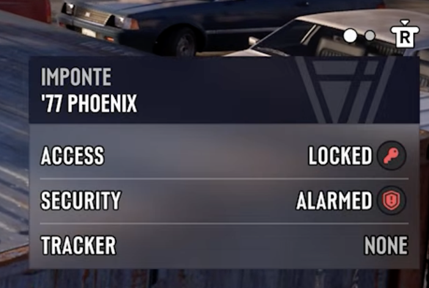

# sxWaink

A vehicle scanner app for **lb-phone**. Players turn the scanner on from their phone, aim at a vehicle with an in game crosshair and get its owner, lock state, performance and condition in a widget. Every scan is kept in the phone history.




## Features

- **Phone app**: a custom lb-phone app to turn the scanner on and off, with stats and the history of the last scans.
- **Crosshair**: an animated crosshair that tightens on a target, shows the scan progress and locks once the vehicle is scanned.
- **Vehicle widget**: three pages, info (owner, lock state, plate), performance (top speed, acceleration, braking, traction) and details (class, seats, fuel, engine), switched with a key.
- **Units**: top speed in km/h or mph, following the game settings or forced in the config.
- **Translations**: English and French, shared between Lua and the interface.
- **Exports**: a client API to drive the crosshair, the widget and the history from your own scan logic.

## Dependencies

| Resource | Purpose |
| --- | --- |
| [lb-phone](https://lbscripts.com) | Required. Hosts the Waink app |

## Installation

1. Clone the repository into your `resources` folder.

   ```bash
   git clone https://github.com/0xS4cha/sxWaink.git
   ```

2. Build the interface, or download a release where `web/dist` is already built.

   ```bash
   cd sxWaink/web
   npm install
   npm run build
   ```

3. Add the resource to your `server.cfg` after lb-phone.

   ```cfg
   ensure lb-phone
   ensure sxWaink
   ```

## Usage

| Key | Description |
| --- | --- |
| `R` | Next page of the vehicle widget |

The key can be changed in *Settings > Key Bindings > FiveM*.

## Configuration

Everything lives in `shared/config.lua`.

| Key | Default | Description |
| --- | --- | --- |
| `Config.Units` | `'auto'` | `'auto'` follows the measurement system of the game settings, `'metric'` forces km/h, `'imperial'` forces mph |
| `Config.Keys.nextPage` | `'R'` | Default key of the next widget page |
| `Config.HistoryLimit` | `30` | Scans kept in the phone history |
| `Config.App` | | Identifier, name, developer, price and default install of the lb-phone app |

### Convars

| Convar | Default | Description |
| --- | --- | --- |
| `sx_locale` | | Forces the language, `setr sx_locale fr` |
| `sx_waink_debug` | `0` | `1` prints trace logs |
| `sx_waink_log_level` | `2` | `0` errors, `1` warnings, `2` info, `3` trace |

## How it works

```
core/           Module loader, class helper, callbacks, logger, translations, utilities
modules/
  app/          lb-phone app, scanner state, widget, history and vehicle stats
  ui/           NUI bridge, translations and units
  exports/      Public client API
shared/         Configuration
translations/   Language files, used by Lua and by the interface
web/            React, TypeScript and Tailwind interface, index.html for the HUD and app.html for the phone
```

The HUD is the `ui_page` of the resource and only shows the crosshair and the widget, it never takes the focus. The phone app is loaded by lb-phone in its own frame and receives its translations with its state when it opens.

## Exports

### Client

| Export | Description |
| --- | --- |
| `IsScannerActive()` | Returns whether the scanner is on |
| `SetScannerActive(active)` | Turns the scanner on or off and updates the phone |
| `SetCrosshair(active, state?, progress?)` | Shows the crosshair, `state` being `'idle'`, `'target'`, `'scanning'` or `'locked'` and `progress` between `0` and `1` |
| `ShowWidget(vehicle, key?)` | Shows the vehicle widget |
| `HideWidget()` | Hides the vehicle widget |
| `IsWidgetVisible()` | |
| `SetWidgetPage(page)` | `'next'`, `'prev'` or a page index, `0` info, `1` performance, `2` details |
| `GetVehicleStats(entity)` | Returns the `performance` and `details` tables of a vehicle |
| `PushScan(vehicle)` | Adds a vehicle to the phone history |
| `GetHistory()` | Returns the history |
| `ClearHistory()` | Clears the history |
| `GetUnits()` | Returns `'metric'` or `'imperial'` |

A vehicle is `{ brand, model, plate, owner, locked, performance?, details? }`. `performance.maxSpeed` is in meters per second, the interface converts it to the selected unit.

```lua
local performance, details = exports.sxWaink:GetVehicleStats(vehicle)
local data = {
    brand = GetLabelText(GetMakeNameFromVehicleModel(GetEntityModel(vehicle))),
    model = GetLabelText(GetDisplayNameFromVehicleModel(GetEntityModel(vehicle))),
    plate = GetVehicleNumberPlateText(vehicle),
    owner = nil,
    locked = GetVehicleDoorLockStatus(vehicle) > 1,
    performance = performance,
    details = details,
}

exports.sxWaink:SetCrosshair(true, 'locked', 1.0)
exports.sxWaink:ShowWidget(data)
exports.sxWaink:PushScan(data)
```

## License

Released under the [MIT License](LICENSE).
